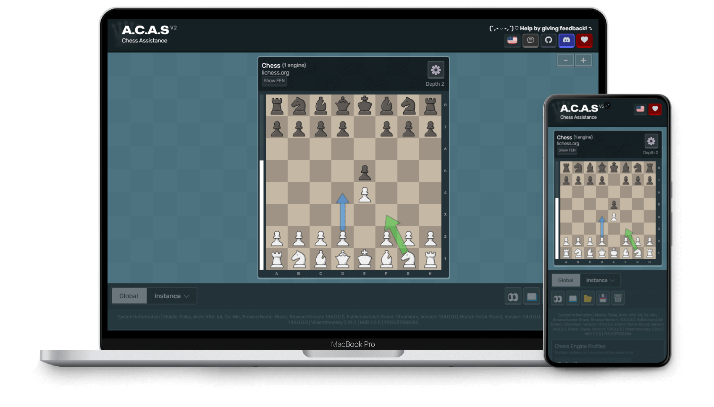

# **Chess.A.C.A.S** (Advanced Chess Assistance System)

> [!WARNING]
> **Chess.A.C.A.S** is a fork of [A.C.A.S (Advanced Chess Assistance System)](https://github.com/Psyyke/A.C.A.S). It was **not written from scratch**: it is based on the original open-source chess assistant, released under the GPL v3 license. Credit for the original work belongs to its upstream authors; this fork only adds the changes listed in "What this fork changes vs. the original" below.

A.C.A.S (Advanced Chess Assistance System) is an open-source chess assistant (**not a chess cheat**), designed to help you make better moves using a chess engine. Just install the userscript, open the A.C.A.S GUI, and you're ready to go. No downloads necessary!

> [!CAUTION]
> The use of A.C.A.S may violate the rules and lead to disqualification or banning from tournaments and online platforms. A.C.A.S is meant to be used as a real-time learning tool. Remember, struggling at chess doesn't mean you're unintelligent... it's not an IQ test, just a board game. And even IQ tests only measure certain aspects of your abilities. Use A.C.A.S fairly, be kind to other players.

| [▶️ Open A.C.A.S](https://chessacas.vercel.app/) | [⬇️ Install (Script)](https://chessacas.vercel.app/acas.user.js)  | [💬 Discuss With Community](https://github.com/thanhbinh-ic/Chess.A.C.A.S/issues)
|-------|-------|-------|

* 3 built-in WebAssembly engines: Gaia 4.4.2, Maia 3, Fairy Stockfish 14 (see below)
* External engines (via an installable localhost server)
* Supports top chess sites (chess.com, lichess.org, etc.)
* Multiple suggestions, arrows, variants, fonts
* Multi-engine support, each with own settings
* Ability to modify any engine UCI options (e.g. ELO, depth, multiPV, skill)
* Visual board metrics (safe, contested, enemy squares, captured pieces)
* Move feedback and opponent predictions
* Render directly on external boards (or stay hidden via ghost mode)
* Audio TTS suggestions with adjustable speed
* Floating panel for stability and faster calculation
* Customizable themes (colors, fonts, textures)
* Chess variants supported (chess960, Fairy Stockfish variants)
* Translated into 30+ languages
* No anti-features on userscript

## What this fork changes vs. the original

This fork is based on [Psyyke/A.C.A.S](https://github.com/Psyyke/A.C.A.S). The changes below are what this fork actually ships, not upstream features:

* **Hosted on Vercel, not GitHub Pages.** The GUI lives at , served from the repo root, so there is no `/A.C.A.S/` URL prefix and no hard-coded upstream host path. The userscript backend was switched to this host; a stored old backend URL is auto-reset on first run.
* **Built-in engines trimmed from ~809 MB to ~154 MB.** Removed Stockfish, Lc0/Zerofish, Maia 2, Lozza, Fusion and the other bundled engines. Only three remain: **Gaia 4.4.2, Maia 3 and Fairy Stockfish 14** (plus the shared `chessjs` / `onnxruntime-web` libraries Maia 3 needs).
* **Gaia 4.4.2 with a real NNUE.** Gaia runs with its NNUE network (`net.bin.deflate`, split into chunks for GitHub's file-size limit) and 3+4-piece tablebases, instead of falling back to the PeSTO evaluation. A dedicated ACAS worker adapter (`Gaia/gaiaWorker.js`) translates between ACAS and Gaia's UCI protocol.
* **Fairy Stockfish fixed for any host.** Upstream `stockfish.js` hard-coded `_scriptDir` to `/A.C.A.S/...`, so Fairy 404'd on every fork. It is now a relative `./stockfish.js`, so the WASM and pthread worker load from the worker's own folder on Vercel, GitHub Pages or localhost.
* **Floating Panel no longer uses Picture-in-Picture.** The suggestion panel opens in a normal popup window (`acas-floating-panel`), so it no longer steals the browser's single PiP slot (YouTube PiP keeps working). Added a Floating Panel Type setting (`window` / `pip`), a single floating window, auto-close when the app tab closes, and the Hidden settings panel is always shown.
* **Move arrows no longer disappear.** Arrows are built before the old ones are cleared, with retries and a redraw on focus, so a packet arriving while another window is clicked can no longer lose the arrows until the next move.
* **Local server accepts the Vercel origin.** `appServer/backend/server.js` allows `Vercel hosts` (the old GitHub Pages origin is kept during the transition), so external engines still work from the Vercel GUI over `ws://localhost:2800`. The Hidden panel's ghost-mode and auto-move options are unchanged upstream features; this fork only makes that panel always available.

  

Used Libraries ❤️

| Library | Description | License |
|--------|------------|---------|
| [Fairy Stockfish WASM](https://github.com/fairy-stockfish/fairy-stockfish.wasm) | Chess engine (variants) | GPL-3.0 |
| [GaiaChess](https://github.com/jromang/gaiachess) | Built-in UCI engine with NNUE (Gaia 4.4.2) | GPL-3.0 |
| [Maia-Chess](https://github.com/CSSLab/maia-chess) | Human-like NN weights (Maia 3) | GPL-3.0 |
| [COI-Serviceworker](https://github.com/gzuidhof/coi-serviceworker) | Enables SharedArrayBuffer / WASM on static hosting (Vercel) | MIT |
| [ChessgroundX](https://github.com/gbtami/chessgroundx) | Chessboard UI (modified) | GPL-3.0 |
| [FileSaver](http://purl.eligrey.com/github/FileSaver.js) | Save config files | MIT |
| [bodymovin (lottie-web)](https://github.com/airbnb/lottie-web) | SVG animations | MIT |
| [chess.js](https://github.com/jhlywa/chess.js) | Game logic (Maia 3) | BSD-2-Clause |
| [onnxruntime-web](https://github.com/Microsoft/onnxruntime) | Run ML models in browser | MIT |
| [Klaro!](https://github.com/klaro-org/klaro-js) | Cookie consent manager | BSD 3-Clause |
| [SnapDOM](https://github.com/zumerlab/snapdom) | DOM → image screenshots | MIT |
| [UniversalBoardDrawer](https://github.com/thanhbinh-ic/Chess.A.C.A.S) | Draw arrows on boards | GPL-3.0 |
| [CommLink](https://github.com/AugmentedWeb/CommLink) | Cross-window communication | GPL-3.0 |
| [Bootstrap Icons](https://getbootstrap.com/) | Icon set | MIT |
| [Mona Sans](https://github.com/github/mona-sans) | Font (GitHub) | SIL Open Font License |
| [Rubik](https://fonts.google.com/specimen/Rubik) | Sans-serif font | SIL Open Font License |
| [IBM Plex Sans](https://github.com/IBM/plex) | IBM typeface | SIL Open Font License |
| [ws](https://github.com/websockets/ws) | WebSocket server library | MIT |
| [Electron](https://www.electronjs.org/) | Desktop app framework | MIT |

There might be more, please let us know if anything is missing, thank you!

| Example 1 | Example 2 |
|---|---|
|  | 

## How does it work?

<table>
<tr>
<th>A.C.A.S (Tab #1)</th>
<th>Chess Website (Tab #2)</th>
</tr>
<tr>
<td></td>
<td></td>
</tr>
<tr>
<td>The engine runs in a completely separate tab from the chess game, keeping it fully isolated from the game page. The chess website cannot block or interfere with A.C.A.S.</td>
<td>A.C.A.S sends move data via <a href="https://github.com/AugmentedWeb/CommLink">CommLink</a>, while the userscript displays the data on the chessboard using <a href="https://github.com/Hakorr/UniversalBoardDrawer">UniversalBoardDrawer</a>. <i>This requires the "Display Moves On External Site" setting to be enabled.</i></td>
</tr>
</table>

If you're having issues, please visit the [troubleshoot](https://chessacas.vercel.app/troubleshoot/) page. Developers can visit the [development](https://chessacas.vercel.app/development/) page. Thank you!

